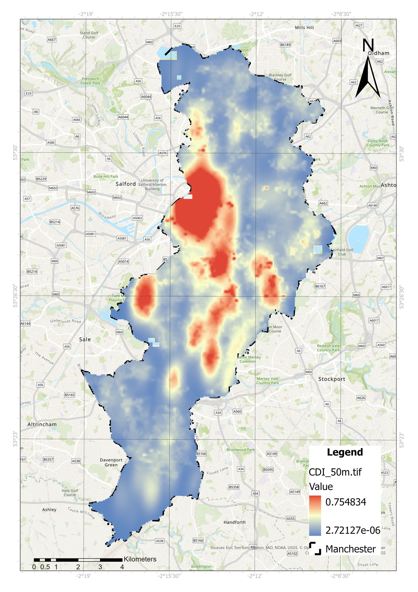
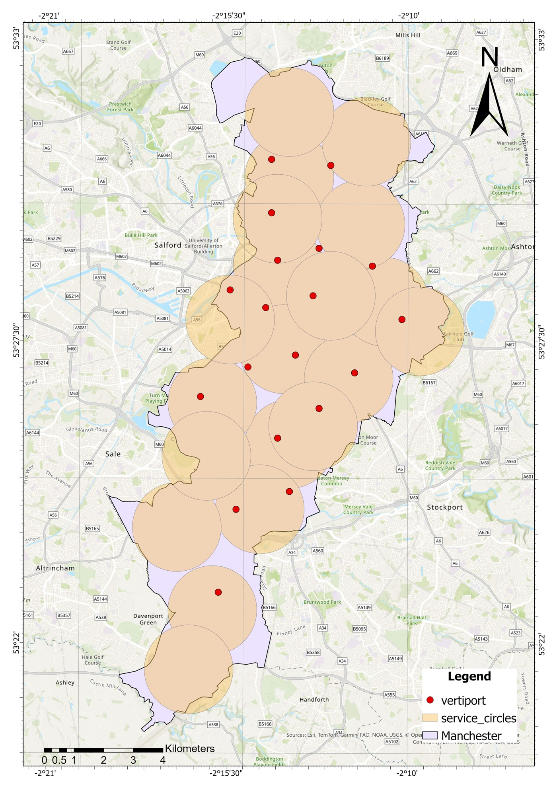
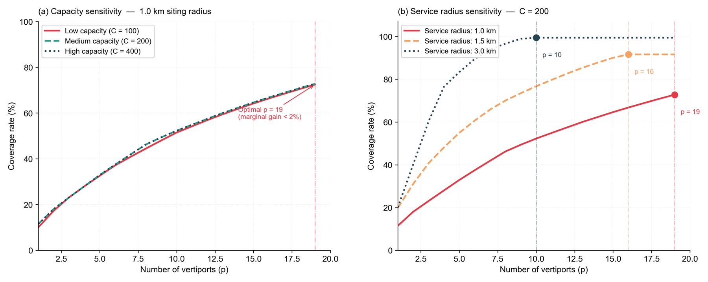
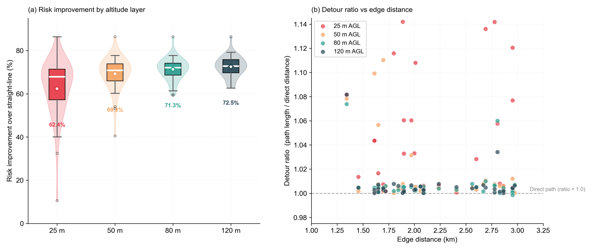
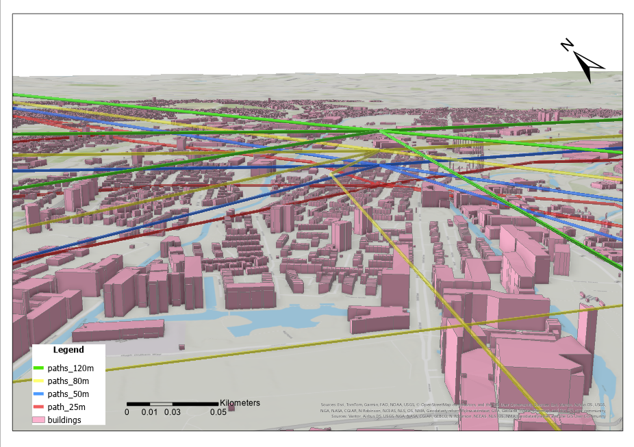

# UAV Vertiport Siting and 3D Risk-Aware Trajectory Planning — Manchester, UK

An integrated GIS pipeline that decides **where to put drone take-off/landing hubs (vertiports)** for urban
food delivery and **how to route drones between them** at lower risk. Built for the MSc GIS dissertation
*"An Integrated GIS Framework for UAV Vertiport Siting and 3D Risk-Aware Trajectory Planning in Urban Food
Delivery: A Case Study of Manchester, UK"* (University of Manchester, 2026).

The pipeline turns open data into a demand map, selects 19 vertiports, builds four altitude-specific risk
maps and plans 3D routes that avoid buildings, wind, GNSS-degraded areas and rail interference.

## Headline results (Manchester City, 237,782 buildings)

| Stage | Result |
|---|---|
| Demand | Composite Demand Index (CDI) from 2,690 matched restaurants and population; strongly clustered (Moran's I ≈ 0.97) |
| Siting | **19 vertiports** cover **88.1 %** of CDI-weighted demand within 1.5 km; selected sites have **2.41×** the mean CDI of the candidate pool; the network is fully connected (40 valid edges, 171 origin–destination pairs) |
| Routing | Risk-aware Theta* routes cut cumulative risk by **62 % (25 m) to 73 % (120 m)** versus straight-line flight, with a path-length detour of only 1.4–10 % |
| Altitude | Every pair of altitude layers differs significantly (Wilcoxon, *p* < 0.001). A composite score (risk 0.7, time 0.3) picks **50 m** most often (39.8 % of OD pairs), then 120 m (27.5 %); 120 m wins in the dense city centre |

<p align="center">
  
  
</p>
<p align="center">
  
</p>
<p align="center">
  
</p>
<p align="center">
  
</p>

## Method in one page

1. **Demand surface (scripts 00–03).** FSA food-hygiene records (XML; missing coordinates are geocoded) are matched to Google Maps places
   (name similarity ≥ 60 **and** distance ≤ 300 m). Each restaurant gets a weight
   `(0.667·Google rating/5 + 0.333·FSA rating/5) · ln(1 + reviews)`. A weighted kernel density
   (Silverman bandwidth ≈ 400 m) and WorldPop population are min-max normalised and averaged with equal
   weights into the CDI at 50 m resolution.
2. **Siting (05–06).** Candidate sites are pre-screened by a multi-criteria score (CDI, road distance,
   building clearance; Jenks classes, equal weights) and legal hard constraints (CAA restricted areas,
   ICAO obstacles). A **capacitated maximal covering location problem** with two radii (siting 1.0 km,
   service 1.5 km), a capacity of 100 and a 3 km connectivity constraint adds vertiports greedily until the
   marginal gain drops below 2 % — which gives *p* = 19.
3. **Risk maps (07).** For each altitude (25, 50, 80, 120 m AGL) a 5 m soft-cost raster combines
   wind (0.35), proximity to obstacle buildings (0.30), GNSS occlusion (0.20) and light-rail interference
   (0.15); weights come from AHP (consistency ratio < 0.1). Hard constraints stay as vectors.
4. **Routing (08).** Any-angle **Theta\*** search with vector 3D line-of-sight tests against building
   polygons (STRtree), then **Dijkstra** over the vertiport network so multi-hop trips are possible
   (cruise 16 m/s, 3 m/s climb, 120 s transfer penalty).
5. **Evaluation (09).** Risk improvement versus straight-line flight, Wilcoxon / paired *t* / Cohen's *d*
   between altitude layers, composite time–risk score and a three-zone (city centre / mid-ring / southern)
   analysis.

## Repository layout

```
config.py                    all paths in one place (relative; override with UAV_DATA_DIR)
restaurant_utils.py          shared helpers for scripts 01-02
00_prepare_fsa.py            Phase 1   FSA XML → clean CSV with one coordinate per business
01_restaurant_ratings.py     Phase 1a  FSA ↔ Google Maps matching, demand weights
02_restaurant_recovery.py    Phase 1b  second-pass matching for chains / trading-name mismatches
03_cdi_surface.py            Phase 2   CDI surface (KDE + population) and validation report
04_buildings.py              Phase 3a  merge OS Building Heights tiles, obstacle layers per altitude
05_vertiport_siting.py       Phase 3b  MCDA pre-screening + capacitated MCLP → 19 vertiports
06_coverage_sensitivity.py   Phase 3c  coverage curves for other service radii / capacities
07_cost_maps.py              Phase 4   4 altitude-specific 5 m soft-cost maps
08_routing.py                Phase 5   Theta* edge routing + Dijkstra multi-hop network routing
09_evaluation.py             Phase 6   statistics, composite score, spatial zones
data/README.md               what data to download and where to put it
docs/figures/                result figures used above
```

## How to run

```bash
python -m venv .venv && source .venv/bin/activate      # Windows: .venv\Scripts\activate
pip install -r requirements.txt

# 1. put the input data in data/raw/ as described in data/README.md
# 2. only for scripts 00-02: a Google Maps Platform API key (Geocoding + Places)
export GOOGLE_MAPS_API_KEY="your-key"                   # Windows: set GOOGLE_MAPS_API_KEY=your-key

python 00_prepare_fsa.py              # → data/processed/restaurants/manchester_fsa_complete.csv
python 01_restaurant_ratings.py
python 02_restaurant_recovery.py
python 03_cdi_surface.py              # → data/processed/cdi/CDI_50m.tif
python 04_buildings.py                # → data/processed/buildings/
python 05_vertiport_siting.py         # → data/processed/vertiports/
python 06_coverage_sensitivity.py
python 07_cost_maps.py                # → data/processed/cost_maps/voxel_output_{25,50,80,120}m/
python 08_routing.py                  # → data/processed/routes/
python 09_evaluation.py               # → data/processed/evaluation/
```

Run the scripts in order: each one reads the output of the previous stages. Scripts 00–02 call a paid
API; if you already have `manchester_restaurants_recovered.csv` you can place it in
`data/processed/restaurants/` and start from script 03. The OS Building Heights data need an academic
licence (EDINA Digimap), so the full pipeline can only be re-run by licence holders.

## Design choices worth knowing

- **Why two radii?** The 1.0 km siting radius keeps vertiports inside restaurant clusters; the 1.5 km
  service radius measures how much demand a drone can actually reach. They are separate on purpose.
- **Capacity.** Each vertiport can serve a limited amount of demand (C = 100, the 25th percentile of
  CDI values), which forces sites to spread across demand centres instead of piling up in the centre.
- **GNSS layer** only uses buildings taller than 10 m; counting every low-rise house overstated
  signal occlusion in suburban areas.
- **Hard vs soft constraints.** Legal/physical limits (restricted airspace, obstacles) are vector
  polygons tested exactly during line-of-sight checks; only gradual risks (wind, proximity, GNSS, rail)
  are rasterised into costs.

## Limitations

- Risk is a relative index built from published risk factors, not a probability of failure.
- Google ratings are a proxy for demand; no order data were available.
- Wind is a 7-year mean surface, not live weather.
- Results are for Manchester City only and depend on the licensed building-height data.

## Author

MSc GIS, University of Manchester. Dissertation code released for portfolio / review purposes.
